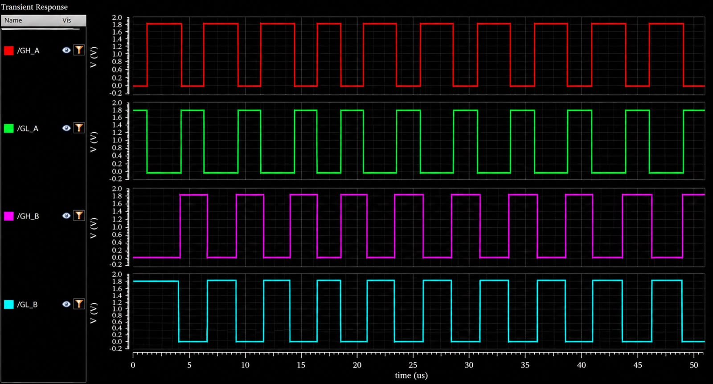
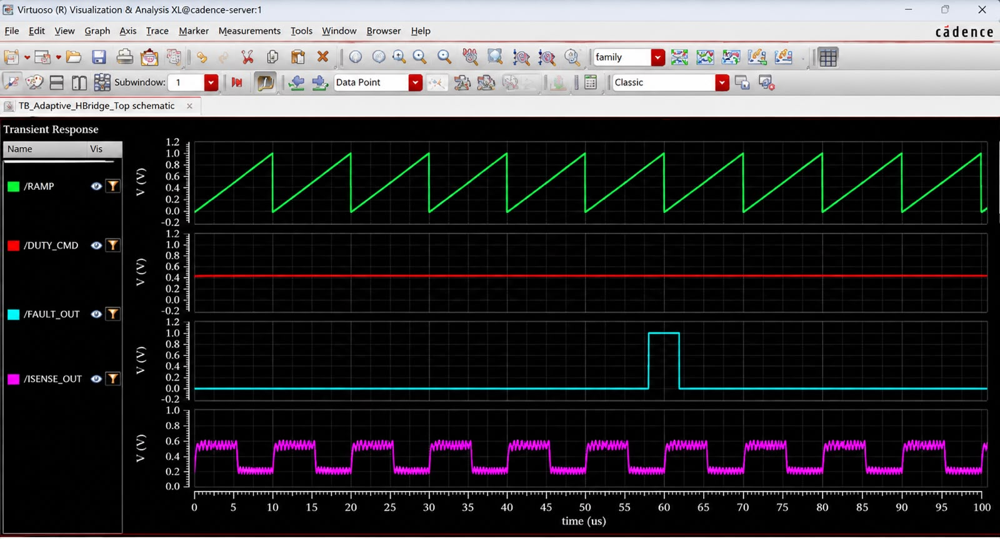
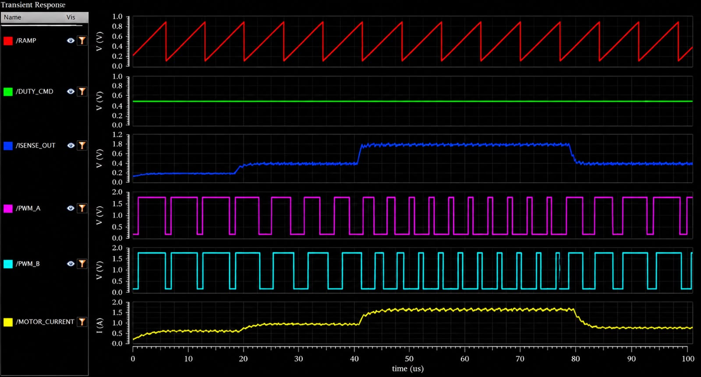
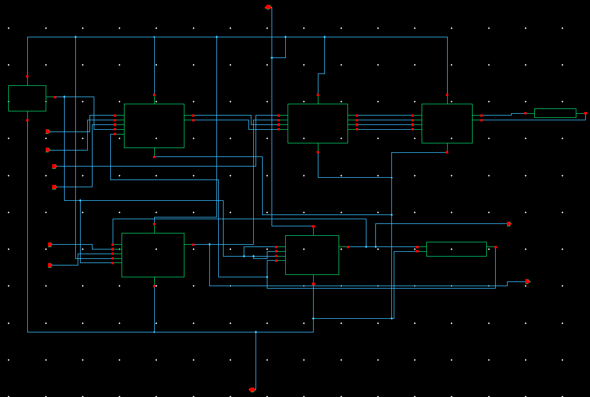

# Load-Aware Adaptive H-Bridge Motor Driver for Robotic Actuators

Cadence Virtuoso design (GPDK 90 nm, `gpdk090`) of a brushed-DC motor driver whose PWM duty **falls as the sensed load current rises**, with dead-time gate drive and UVLO / overcurrent protection in a single hierarchy.

Final project review, 23 October 2026 — Ashmit Singh, B.Tech Electronics Engineering (VLSI Design & Technology), VIT Vellore.

> Slides: [`docs/Adaptive_HBridge_Final_Review.pptx`](docs/Adaptive_HBridge_Final_Review.pptx) ([PDF](docs/Adaptive_HBridge_Final_Review.pdf))

## Idea

| SENSE | ADAPT | DRIVE |
|---|---|---|
| Shunt current → voltage | Duty follows load current | H-bridge with dead-time |

Fixed-duty PWM ignores load current, and current limits are usually fixed or protection-only. This design senses motor current with a shunt + amplifier and lowers duty before the hard overcurrent trip. It builds on Dong et al., *IEICE Electronics Express* 2025 (integrated current sensing in a stepper driver) and extends it to a brushed-DC actuator with load-aware PWM. It is an extension of those papers, not a claim of absolute novelty.

## Key results (simulation, 1.8 V, gpdk090)

- Motor current range in the adaptive run: ~0.6 A – 1.7 A
- At a fixed duty command (~0.5 V), PWM duty falls from roughly **85 % to 35 %** as current rises from ~0.95 A to 1.7 A, and recovers when load falls (read from plot)
- Gate driver outputs swing the full 0–1.8 V; GL is the complement of GH on each leg
- FAULT_OUT asserts once (~58–62 µs) in the top-level run, then clears

| Gate driver outputs | Top-level testbench | PWM duty vs load current |
|---|---|---|
|  |  |  |

## Repository layout

```
.
├── cadence/
│   ├── VLSI_Proj/            # Virtuoso (OpenAccess) library — all cells
│   └── cds.lib.example       # template for your own cds.lib
└── docs/
    ├── Adaptive_HBridge_Final_Review.pptx / .pdf
    ├── figures/              # schematic + concept figures from the review
    ├── waveforms/            # simulation results
    └── screenshots/          # Virtuoso schematic-editor screenshots
```

## Design hierarchy

`Adaptive_HBridge_Top` has eight instances:

| Inst | Cell | Contents |
|---|---|---|
| I0 | `Adaptive_PWM` | OP_Amp, Comparator, CMOS_Inv, 2× NAND2, input RC networks |
| I1 | `Protection` | Bias_Reference, Overcurrent_Protection, Undervoltage_Lockout, Fault_Logic |
| I2 | `Gate_Driver` | 2× Dead_Time (one per leg), 2× Schmitt_Trigger, NAND2, CMOS_Inv, 4× Output_Buffer |
| I3 | `Sense_Amplifier` | OP_Amp with resistor / capacitor network |
| I4 | `HBridge` | 2× pmos2v_3 + 2× nmos2v_3 (gpdk090) |
| I5 | `Current_Sense` | Shunt-based current sensing |
| I6 | `Motor_Model` | R-L motor load model |
| I7 | `Bias_Reference` | Bias generation |

Shared low-level cells: `CMOS_Inv`, `NAND2`, `NOR2`, `Schmitt_Trigger`, `RC_Delay`, `Comparator`, `OP_Amp`.
Testbench: `TB_Adaptive_HBridge_Top`.

Top-level ports — inputs: `DIR`, `DRIVER_EN`, `DUTY_CMD`, `RAMP`, `RESET`, `Vdd_Sense`; outputs: `FAULT_OUT`, `I_SENSE_OUT`.



### Blocks

| Block | Summary | Figure |
|---|---|---|
| H-bridge | Leg 1: M2 (PMOS) over M0 (NMOS) → OUT1; leg 2: M3 over M1 → OUT2. W = 150 nm, L = 280 nm, 2 V devices | [schematic](docs/figures/HBridge_schematic.png) |
| Gate driver | FAULT inverted and NAND-ed with DRIVER_IN; two RC_Delay cells set dead-time (~100 ns = 0.69·Rd·Cd, 10 kΩ / 15 pF) | [schematic](docs/figures/Gate_Driver_schematic.png), [Dead_Time](docs/figures/Dead_Time_schematic.png) |
| Current sense | V_SENSE = I·Rs, Rs = 100 mΩ; RC filter ≈ 3.4 kHz | [concept](docs/figures/Current_Sense_concept.png) |
| Sense amplifier | OP_Amp scales shunt voltage into ISENSE_OUT and feedback to Adaptive_PWM | [schematic](docs/figures/Sense_Amplifier_schematic.png) |
| Overcurrent | Comparator + Schmitt_Trigger → OC_Raw; trip set by Voc_Ref (target 1.65 A) | [schematic](docs/figures/Overcurrent_Protection_schematic.png) |
| UVLO | Vdd_Sense / Vuv_Ref dividers, Comparator + Schmitt_Trigger → Uv_Trip | [schematic](docs/figures/Undervoltage_Lockout_schematic.png) |
| Fault logic | Cross-coupled NOR2 SR latch: set by OC_Trip / UV_Trip, cleared by RESET | [schematic](docs/figures/Fault_Logic_schematic.png) |
| Adaptive PWM | OP_Amp (DUTY_CMD + Vsense) → Comparator vs ramp → CMOS_Inv + 2× NAND2 steer PWM_A / PWM_B by DIR | [op-amp](docs/figures/Adaptive_PWM_opamp_stage.png), [modulator](docs/figures/Adaptive_PWM_modulator_schematic.png) |

H-bridge switch states (gate levels GH_A, GL_A, GH_B, GL_B): Forward `0 0 1 1`, Reverse `1 1 0 0`, Brake `1 1 1 1`, Coast `1 0 1 0`. PMOS conducts when its gate is low; never drive GH = 0 with GL = 1 on one leg (shoot-through).

## Testbench setup (`TB_Adaptive_HBridge_Top`)

V0 supply 1.8 V · V1 DIR 0 V · V2 DRIVER_EN 1.8 V · V3 DUTY_CMD DC ≈ 0.5 V · V4 RAMP pulse 0–1 V, 10 µs period · V5 RESET 1.8 V · V6 Vdd_Sense 1.8 V · 1 pF loads on FAULT_OUT and I_SENSE_OUT. Transient analysis, Spectre.

## Opening the design in Virtuoso

1. Clone the repo and copy `cadence/cds.lib.example` to your working directory as `cds.lib`; fix the `gpdk090` path (the PDK is **not** included).
2. Make sure `VLSI_Proj` points to `cadence/VLSI_Proj`.
3. Launch `virtuoso &`, open library `VLSI_Proj`, cell `TB_Adaptive_HBridge_Top`, view `schematic`, then Launch → ADE L and run the `tran` analysis (0 – 100 µs).

Cadence lock files (`*.cdslck*`) were removed and are git-ignored.

## Limitations / future work

- Simulated with gpdk090 2 V devices at 1.8 V and ~1.7 A. The 1–5 A, 6–24 V target needs high-voltage devices; the UVLO thresholds (8.0 V fall / 8.5 V rise) belong to that target and are not exercised by the 1.8 V testbench.
- Dead-time is a fixed RC delay (~100 ns, below the resolution of the 50 µs plots); adaptive dead-time (He et al., 2026) is future work.
- On-chip current sensing (cascode mirrors), over-temperature protection, and real motor / robotic-load validation are future work.
- Duty percentages are read from the plots.

## References

1. Zhang et al., "Design of Fully-Integrated H-Bridge for DC Motor Driver IC, 0.5-µm HV CMOS," 2010.
2. Xu et al., "Monolithic H-bridge brushless DC vibration motor driver with a highly sensitive Hall sensor," 2012.
3. Krenzke et al., "A 36-V H-bridge driver interface in a standard 0.35-µm CMOS process," 2003.
4. D. Dong, J. Leng, Z. Li, B. Lei, "A fully integrated stepper motor driver with a novel integrated current sensing technology," *IEICE Electronics Express*, vol. 22, no. 10, art. 20250071, 2025, doi:10.1587/elex.22.20250071.
5. J. He, H. Yu, D. Dong, D. Xie, M. Huang, adaptive dead-time high-side gate driver, *Microelectronics Journal*, vol. 167, 2026, art. 106937, doi:10.1016/j.mejo.2025.106937.

## License

No license has been chosen yet — add a `LICENSE` file before making the repo public.
